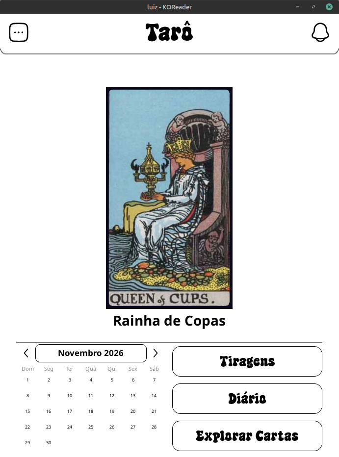
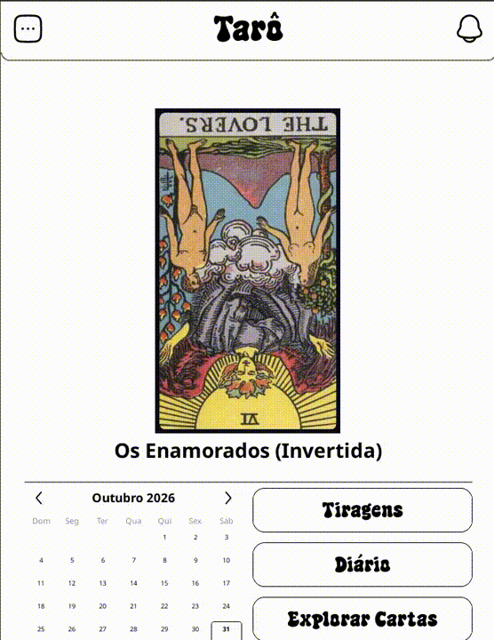

# Arcana II — Tarot & Lenormand for KOReader

Explore Tarot, Lenormand, and your personal library directly on your e-reader.

Draw cards, discover their meanings, create readings, save reflections, and organize books about Tarot, astrology, occultism, spirituality, and much more — all within Arcana II.

---

## English

### Features

**Tarot & Lenormand**
- Support for Tarot and Lenormand decks.
- Daily Card with personal reflections.
- Customizable readings with up to 36 cards.
- Hidden Card spread with a 6×6 grid.
- Physical Deck mode.
- Card Guide with meanings and interpretations.
- Use book highlights as personal card meanings.
- Calendar with moon phases.
- Reflection Journal to save and organize your experiences.

**Personal Library**
- Add and read books about Tarot, astrology, occultism, spirituality, literature, and more without leaving Arcana II.
- Read books using KOReader's built-in reading engine.
- Organize books with collections, including smart collections.
- Search for book metadata and covers online.
- Rate books, save favorites, and filter your collection.
- Switch between list and bookshelf views.
- Return directly to the Arcana II Library after reading.

**Interface & Customization**
- Customizable home screen with swipe navigation between modules.
- Optional modules and personalized shortcuts.
- Expanded quick settings for device controls.
- PIN protection with a lock screen clock.
- Optional Super Maples font for selected interface elements.
- Adaptive fullscreen interface designed for e-ink screens.
- Optimized cover caching, navigation, and screen refreshing.
- Available in English, Portuguese, Brazilian Portuguese, Spanish, and Simplified Chinese.

### Installation

1. Download the latest Arcana II release.
2. Extract the ZIP file.
3. Copy the `tarot.koplugin` folder to `koreader/plugins/`.
4. Restart KOReader.
5. Open Arcana II from the Tools menu.

Existing users can update without intentionally deleting their personal data and settings. Backing up your files before updating is recommended.

### Version

**Arcana II — 7.0**

---

## Português

### Sobre o Arcana II

O Arcana II é um plugin de Tarô e Lenormand para o KOReader, desenvolvido para proporcionar uma experiência de leitura, reflexão e exploração de cartas diretamente no seu dispositivo.

Tire cartas, descubra seus significados, realize tiragens, registre reflexões e organize seus livros sobre Tarô, astrologia, ocultismo, espiritualidade e muito mais — tudo dentro do Arcana II.

### Funcionalidades

**Tarô e Lenormand**
- Suporte a baralhos de Tarô e Lenormand.
- Carta Diária com reflexões pessoais.
- Tiragens personalizáveis com até 36 cartas.
- Tiragem de Carta Oculta em uma grade 6×6.
- Modo Baralho Físico.
- Guia de Cartas com significados e interpretações.
- Utilize destaques de livros como significados pessoais das cartas.
- Calendário com fases da lua.
- Diário de Reflexões para registrar e organizar suas experiências.

**Biblioteca pessoal**
- Adicione e leia livros sobre Tarô, astrologia, ocultismo, espiritualidade, literatura e outros assuntos sem precisar sair do Arcana II.
- Leia livros utilizando o leitor integrado do KOReader.
- Organize seus livros em coleções, incluindo coleções inteligentes.
- Pesquise metadados e capas online.
- Avalie livros, marque favoritos e utilize filtros.
- Alterne entre visualização em lista e prateleira.
- Retorne diretamente à Biblioteca do Arcana II após a leitura.

**Interface e personalização**
- Página inicial personalizável, com navegação por gestos entre os módulos.
- Módulos opcionais e atalhos configuráveis.
- Cabeçalho expandido com controles do dispositivo.
- Proteção por PIN e relógio na tela de bloqueio.
- Fonte Super Maples opcional em elementos da interface.
- Interface adaptável à tela inteira, desenvolvida para dispositivos e-ink.
- Otimizações no cache de capas, na navegação e na atualização da tela.
- Disponível em inglês, português, português brasileiro, espanhol e chinês simplificado.

### Instalação

1. Baixe a versão mais recente do Arcana II.
2. Extraia o arquivo ZIP.
3. Copie a pasta `tarot.koplugin` para `koreader/plugins/`.
4. Reinicie o KOReader.
5. Abra o Arcana II pelo menu de Ferramentas.

Usuários de versões anteriores podem atualizar sem excluir intencionalmente seus dados pessoais e configurações. Recomenda-se realizar um backup antes da atualização.

### Versão

**Arcana II — 7.0**

---

## Español

### Acerca de Arcana II

Arcana II es un complemento de tarot y Lenormand para KOReader, diseñado para ofrecer una experiencia de lectura, reflexión y exploración de cartas directamente en tu dispositivo.

Saca cartas, descubre sus significados, realiza tiradas, guarda reflexiones y organiza libros sobre tarot, astrología, ocultismo, espiritualidad y mucho más, todo dentro de Arcana II.

### Características

**Tarot y Lenormand**
- Compatibilidad con barajas de tarot y Lenormand.
- Carta del Día con reflexiones personales.
- Tiradas personalizables de hasta 36 cartas.
- Tirada de Carta Oculta con una cuadrícula de 6×6.
- Modo Baraja Física.
- Guía de Cartas con significados e interpretaciones.
- Utiliza fragmentos destacados de libros como significados personales de las cartas.
- Calendario con fases lunares.
- Diario de Reflexiones para guardar y organizar tus experiencias.

**Biblioteca personal**
- Añade y lee libros sobre tarot, astrología, ocultismo, espiritualidad, literatura y otros temas sin salir de Arcana II.
- Lee libros utilizando el lector integrado de KOReader.
- Organiza libros mediante colecciones, incluidas las colecciones inteligentes.
- Busca metadatos y portadas en línea.
- Califica libros, marca favoritos y utiliza filtros.
- Alterna entre las vistas de lista y estantería.
- Regresa directamente a la Biblioteca de Arcana II después de leer.

**Interfaz y personalización**
- Pantalla de inicio personalizable con navegación mediante gestos entre módulos.
- Módulos opcionales y accesos directos configurables.
- Panel de ajustes rápidos ampliado con controles del dispositivo.
- Protección mediante PIN y reloj en la pantalla de bloqueo.
- Fuente Super Maples opcional en elementos de la interfaz.
- Interfaz adaptable a pantalla completa, diseñada para dispositivos de tinta electrónica.
- Optimizaciones en la caché de portadas, la navegación y la actualización de pantalla.
- Disponible en inglés, portugués, portugués de Brasil, español y chino simplificado.

### Instalación

1. Descarga la última versión de Arcana II.
2. Extrae el archivo ZIP.
3. Copia la carpeta `tarot.koplugin` en `koreader/plugins/`.
4. Reinicia KOReader.
5. Abre Arcana II desde el menú Herramientas.

Los usuarios de versiones anteriores pueden actualizar sin eliminar intencionadamente sus datos personales y configuraciones. Se recomienda realizar una copia de seguridad antes de actualizar.

### Versión

**Arcana II — 7.0**

---

## 简体中文

### 关于 Arcana II

Arcana II 是一款适用于 KOReader 的塔罗牌与雷诺曼卡插件，旨在让用户直接在电子阅读器上体验抽牌、解读、占卜与个人反思。

你可以抽取卡牌、查看牌义、进行牌阵占卜、记录心得，还可以整理与阅读塔罗牌、占星术、神秘学、灵性以及其他主题的书籍，无需离开 Arcana II。

### 主要功能

**塔罗牌与雷诺曼卡**
- 支持塔罗牌和雷诺曼卡牌组。
- 每日一牌与个人感悟记录。
- 可自定义牌阵，最多支持 36 张卡牌。
- 使用 6×6 网格的隐藏卡牌牌阵。
- 实体牌组模式。
- 牌卡图鉴，提供牌义与解读。
- 可以将书籍中的划线摘录用作个人牌义。
- 带有月相信息的日历。
- 反思日记，用于保存和整理个人体验。

**个人书库**
- 无需离开 Arcana II，即可添加和阅读有关塔罗牌、占星术、神秘学、灵性、文学及其他主题的书籍。
- 使用 KOReader 内置阅读器阅读书籍。
- 通过收藏集整理书籍，包括智能收藏集。
- 在线搜索书籍元数据和封面。
- 为书籍评分、添加收藏并使用筛选功能。
- 在列表视图和书架视图之间切换。
- 阅读结束后可直接返回 Arcana II 书库。

**界面与个性化设置**
- 可自定义主页，支持通过滑动手势切换模块。
- 可选模块与自定义快捷方式。
- 扩展快捷设置面板，方便控制设备功能。
- PIN 码保护与锁屏时钟。
- 部分界面元素可选用 Super Maples 字体。
- 专为电子墨水屏设计的自适应全屏界面。
- 优化封面缓存、页面导航和屏幕刷新。
- 支持英语、葡萄牙语、巴西葡萄牙语、西班牙语和简体中文。

### 安装方法

1. 下载最新版本的 Arcana II。
2. 解压 ZIP 文件。
3. 将 `tarot.koplugin` 文件夹复制到 `koreader/plugins/` 目录。
4. 重新启动 KOReader。
5. 从工具菜单中打开 Arcana II。

旧版本用户可以在不主动删除个人数据和设置的情况下进行更新。建议在更新前备份文件。

### 版本

**Arcana II — 7.0**

---

## Card Artwork Credits / Créditos das Cartas / Créditos de las Cartas / 卡牌图片致谢

- **Lenormand Cards:** Yve Lepkowski — https://stolen-thyme.com/
- **Tarot Cards:** Luciella Elisabeth Scarlett — https://luciellaes.itch.io/

---

**Arcana II — Tarot, Lenormand & Reading for KOReader**
